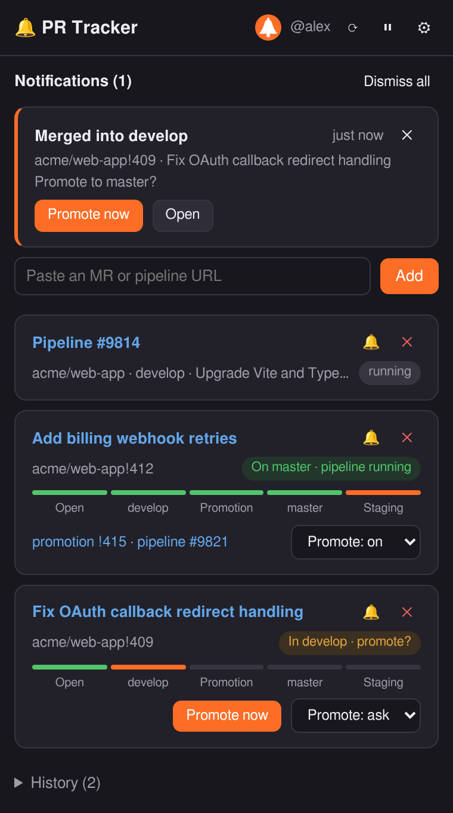
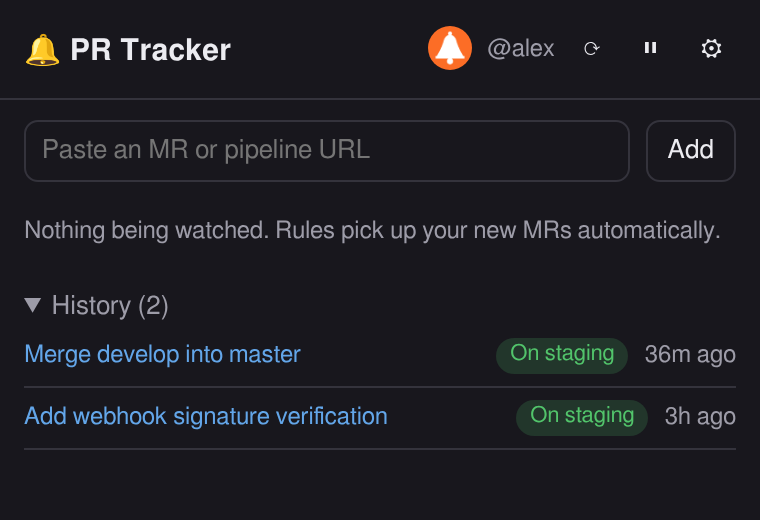
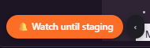
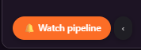
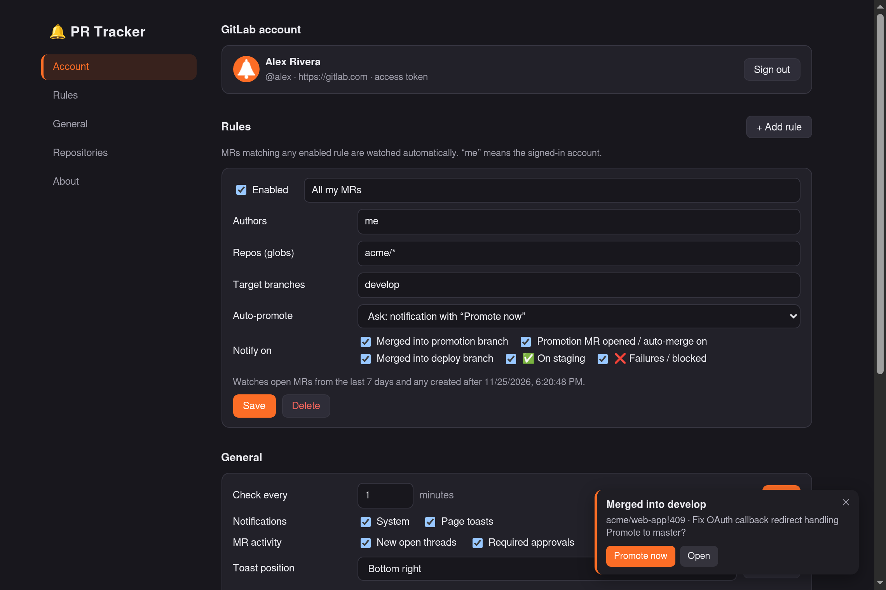
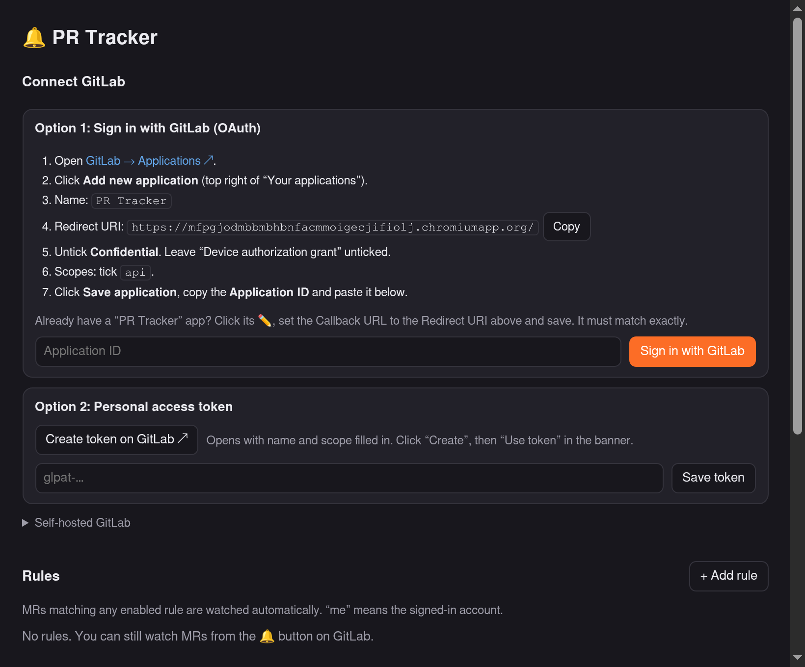

# PR Tracker

Chrome extension for tracking GitLab merge requests from merge to staging, with optional automatic branch promotion and pipeline notifications.

## Why

In teams using a two-branch release flow (for example `develop -> master`), merging a feature MR into `develop` does not mean the change is live on staging yet — it still needs to be promoted and pass the deploy branch pipeline. Even on simpler single-branch repos (`feature -> main/master`), you still have to keep checking whether the post-merge pipeline passed.

PR Tracker follows each MR through every stage in the background and notifies you when something needs attention or when your change is actually on staging.

> **Note on branch promotion:** The `develop -> master` promotion step is specific to that workflow and is completely optional. Repositories without a `develop` branch skip promotion automatically, and you can disable promotion for any repository in Settings (leave **Promote from** empty) or set **Auto-promote** to `off` per rule or per MR.

## Screenshots

| Active watches & notifications | History |
| :---: | :---: |
|  |  |

| In-page MR watch button | In-page pipeline watch button |
| :---: | :---: |
|  |  |

| Settings | Connect GitLab |
| :---: | :---: |
|  |  |

## Features

- **End-to-end MR tracking:** Follows MRs through `open` -> `develop` -> `promotion MR` -> `master/main` -> `staging` (or directly `open` -> `master/main` -> `staging` for repos without a promotion branch).
- **Optional auto-promotion:** Configure per rule or per MR to either just watch (`off`), prompt you with a "Promote now" button (`ask`), or automatically open the `develop -> master` MR and enable auto-merge (`on`). Source branches are never deleted.
- **Standalone pipeline tracking:** Watch any individual GitLab pipeline and get notified when it passes, fails (with failed job names), is canceled, or waits on a manual job.
- **Rules:** Automatically pick up new MRs by author (`me` or specific usernames), repository glob patterns, and target branches.
- **Notifications:** Desktop notifications, customizable in-page toasts on GitLab tabs (configurable corner in Settings), and an unread notification feed in the popup.
- **Repository auto-detection:** Automatically detects `develop` + `master`/`main` branch layouts on first watch, with manual overrides in Settings.
- **Local storage:** Active watches and settings live in `chrome.storage.local`; completed history and seen records are stored in IndexedDB.

## Install

Requires Node.js 24+.

```sh
npm install
npm run build
```

1. Open `chrome://extensions`.
2. Enable **Developer mode**.
3. Click **Load unpacked** and select the `dist/` directory.

## Connect GitLab

Open the extension's **Settings** page (opens automatically on install, or via the gear icon in the popup). Self-hosted HTTPS GitLab instances can be configured under **Self-hosted GitLab**.

### Option 1: OAuth (PKCE)

1. Open `https://gitlab.com/-/user_settings/applications` (or your self-hosted equivalent) and click **Add new application**.
2. Set **Name** to `PR Tracker`.
3. Set **Redirect URI** to the URI shown on the Settings page (`https://mfpgjodmbbmbhbnfacmmoigecjifiolj.chromiumapp.org/` for dev builds).
4. Uncheck **Confidential** and leave device authorization grant unchecked.
5. Check the `api` scope and save.
6. Paste the **Application ID** into Settings and click **Sign in with GitLab**.

### Option 2: Personal Access Token

1. Click **Create token on GitLab** in Settings to open the GitLab token form pre-filled with the `api` scope.
2. Create the token, then click **Use token** in the banner on the GitLab page (or paste the token manually in Settings).

## Usage

- **Automatic tracking:** On first sign-in, a default `"All my MRs"` rule is created. Adjust or add rules in Settings.
- **Manual tracking:** Use the floating watch button on any GitLab MR or pipeline page, or paste an MR/pipeline URL in the popup.
- **Notifications & toasts:** Toggle system notifications, in-page GitLab toasts, and toast corner position (`Bottom right`, `Bottom left`, `Top right`, `Top left`) in Settings.

Polling runs via `chrome.alarms` while Chrome is open and catches up automatically when Chrome restarts.

## Development

```sh
npm run watch          # rebuild on file changes (scripts + static assets)
npm run typecheck      # TypeScript check
npm test               # run state-machine and client tests
npm run build:release  # minified build without dev manifest key or sourcemaps
npm run pack           # package dist/ into release/*.zip and release/*.crx
```

## Maintenance

This repository is provided as-is and will not be actively maintained unless critical issues need attention.

## License

[MIT](LICENSE)
